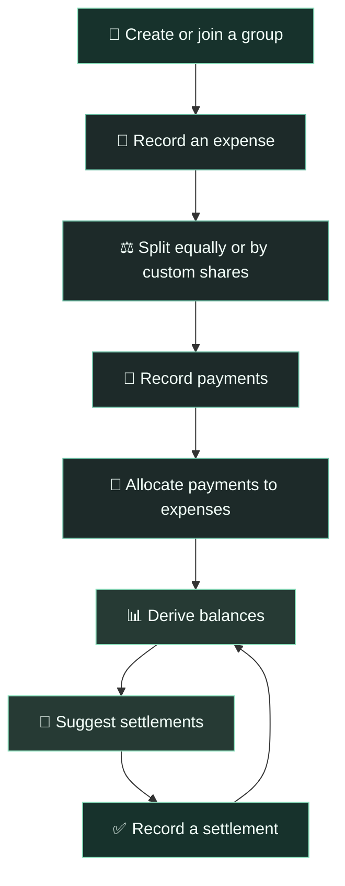
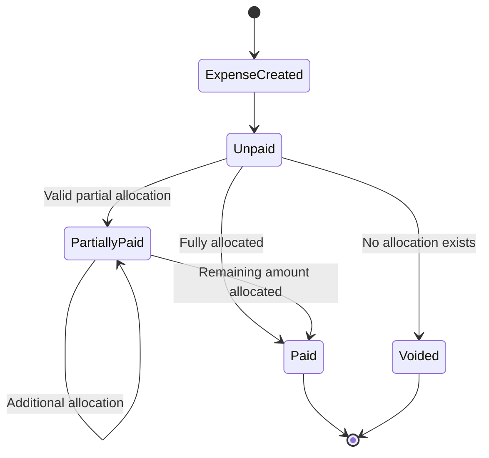
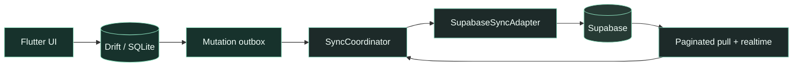

<div align="center">


<p><strong>A local-first shared expense ledger for trips, homes, couples, and small teams.</strong></p>

<p>
  Track expenses, allocate payments, understand balances, and settle up —
  with an offline-first ledger that stays usable even without cloud credentials.
</p>

<br/>

<a href="https://github.com/madhav-manchanda/udhaM/stargazers"></a>
<a href="https://github.com/madhav-manchanda/udhaM/issues"></a>
<a href="./LICENSE"></a>
<a href="https://github.com/madhav-manchanda/udhaM"></a>

<br/><br/>


<br/><br/>

<a href="#-why-udham">WHY UDHAM</a> &nbsp;·&nbsp;
<a href="#-how-it-works">HOW IT WORKS</a> &nbsp;·&nbsp;
<a href="#-features">FEATURES</a> &nbsp;·&nbsp;
<a href="#-accounting-model">ACCOUNTING</a> &nbsp;·&nbsp;
<a href="#-getting-started">SETUP</a> &nbsp;·&nbsp;
<a href="#-architecture">ARCHITECTURE</a>

<br/><br/>


</div>

## ✦ Why UdhaM?

Splitting a bill is easy. Keeping track of who paid, who owes, how partial payments were allocated, and what remains to settle is where things get complicated.

UdhaM treats those as separate, explainable ledger records. Expenses do not silently create payments, balances are derived from the ledger, and settlement suggestions never change anyone's balance until a settlement is recorded.

<div align="center">

| Record | What it means |
|:---:|:---|
| **Expense** | What was spent and how the cost is shared |
| **Payment** | Money actually paid and explicitly allocated |
| **Balance** | A derived view of shares, payments, and transfers |
| **Settlement** | A recorded transfer that brings balances closer to zero |

</div>

<div align="center">
  
</div>

> [!NOTE]
> **Local-first by design:** changes are written to Drift/SQLite and a durable outbox first. Supabase synchronization is optional. Without Supabase credentials, UdhaM remains a functional local-only ledger.

## ✦ How it works

<div align="center">



</div>

### A simple ledger example

Suppose Alex pays ₹1,200 for a shared meal between Alex, Blair, and Casey.

- The expense is recorded as ₹1,200.
- Each person's share is ₹400.
- The expense does **not** automatically become a payment from everyone.
- When Blair pays Alex ₹400, that payment is recorded and allocated to the relevant expense.
- The ledger recalculates the remaining balances from those records.

<details>
<summary><strong>See the balance model</strong></summary>

UdhaM's balance formula is:

```text
Balance =
    payments made
  - shares owed
  + settlement delta
  + adjustment delta
```

A positive or negative balance is derived from valid ledger activity, not manually edited as a shortcut. A transfer from one participant to another increases the sender's balance and decreases the receiver's balance.

</details>

## ✦ Features

<table>
<tr>
<td width="50%" valign="top">

### 👥 Groups & people
- Multiple groups
- Invite codes and guest participants
- Guest-to-profile linking
- Roles and ownership transfer
- Archive and delete flows

</td>
<td width="50%" valign="top">

### 🧾 Expenses & splits
- Equal and custom splits
- Expected payer
- Categories and notes
- Edit, void, and delete flows
- Derived unpaid / partial / paid states

</td>
</tr>
<tr>
<td width="50%" valign="top">

### 💸 Payments & settlements
- Explicit payment records
- Allocation across multiple expenses
- Partial and multiple payments
- Full-allocation validation
- Reversible settlements and adjustments

</td>
<td width="50%" valign="top">

### 📥 Smart Inbox
- On-device SMS parsing
- Paste and manual ingestion
- Duplicate detection
- Review before importing
- Convert candidates into ledger records or personal transactions

</td>
</tr>
<tr>
<td width="50%" valign="top">

### 📡 Offline-first sync
- Local Drift / SQLite database
- Durable mutation outbox
- Idempotent pushes and retry handling
- Paginated pull and conflict states
- Supabase Realtime reconciliation

</td>
<td width="50%" valign="top">

### 🧾 Receipts & history
- Private on-device receipt storage
- File type and size validation
- SHA-256 checksums
- Retryable upload state
- Activity history for ledger changes

</td>
</tr>
</table>

## ✦ Accounting model

UdhaM keeps the ledger explainable by following a few strict rules:

1. **Money uses integer minor units.** INR amounts are stored in paise, never floating-point values.
2. **Expenses and payments are separate.** Creating an expense never creates a payment.
3. **Expected payer is informational.** It does not mean money has been paid.
4. **Payments must be fully allocated.** A payment cannot be saved with unallocated value.
5. **Expense status is derived.** Unpaid, partially paid, paid, and voided states follow valid allocations.
6. **Voiding is constrained.** An expense can only be voided when nothing has been allocated to it.
7. **Suggestions are read-only.** Settlement suggestions never mutate balances; recording a settlement does.

### Ledger lifecycle



## ✦ Offline-first synchronization

UdhaM is designed to keep local actions available even when the network is not.

<div align="center">



</div>

The synchronization layer includes:

- A durable `client_mutations` outbox.
- Idempotent mutation pushes.
- Retry and conflict states.
- Crash recovery.
- Full paginated pull.
- Supabase Realtime subscriptions.

Without Supabase credentials, mutations are acknowledged locally and the ledger does not block. With credentials but no signed-in session, pushes remain in the outbox and can be retried after sign-in.

## ✦ Architecture

UdhaM is organized around feature modules and clear domain/data boundaries.

```text
lib/
├── app/          app shell, router, Riverpod providers, theme
├── core/         database, money, errors, enums, sync outbox
├── features/
│   ├── auth/
│   ├── groups/
│   ├── expenses/
│   ├── payments/
│   ├── balances/
│   ├── settlements/
│   ├── receipts/
│   ├── activity/
│   ├── smart_inbox/
│   └── settings/
└── shared/       formatting and common widgets
```

| Layer | Technology / responsibility |
|:---|:---|
| Presentation | Flutter, Riverpod, GoRouter |
| Local persistence | Drift / SQLite |
| Domain | Pure Dart split, allocation, balance, and SMS parsing engines |
| Sync boundary | `SyncAdapter` and `SyncCoordinator` |
| Cloud sync | `SupabaseSyncAdapter`, paginated pull, idempotent push, realtime |
| Attachments | Private app documents directory, optional private Supabase Storage |
| Authentication | Local auth repository and Supabase-backed Google OAuth adapter |

## ✦ Getting started

### Requirements

- Flutter SDK compatible with the project.
- Dart SDK supplied by Flutter.
- Android Studio / Android SDK for Android builds.
- Supabase project only when cloud sync and remote authentication are needed.

### 1. Clone the repository

```bash
git clone https://github.com/madhav-manchanda/udhaM.git
cd udhaM
```

### 2. Install dependencies

```bash
flutter pub get
dart run build_runner build --delete-conflicting-outputs
```

Generated Drift code is checked in at `lib/core/database/app_database.g.dart`. Regenerate it after changing database tables.

### 3. Run the app

```bash
flutter run
```

The app can run as a local-only ledger without Supabase credentials.

### 4. Run checks

```bash
flutter analyze
flutter test
```

The integration tests use an in-memory SQLite database. On Linux they load the system `libsqlite3.so.0`.

## ✦ Optional cloud sync setup

1. Copy `.env.example` to `.env`.
2. Configure `SUPABASE_URL`, `SUPABASE_ANON_KEY`, `SUPABASE_REDIRECT_URL` and, when needed, `SUPABASE_STORAGE_BUCKET`.
3. Apply migrations in `supabase/migrations/` in filename order using `supabase db push`, or through the Supabase SQL editor as the project owner.
4. Enable the Google provider in Supabase Auth.
5. Add the redirect URL from `.env` to the Supabase Auth URL configuration.
6. Run the app with:

```bash
flutter run --dart-define-from-file=.env
```

> [!TIP]
> Cloud sync is optional. You can explore and use the local ledger before configuring a Supabase project.

## ✦ Platforms & release notes

Android, iOS, and Linux runners are generated. The native Android SMS receiver, runtime permissions, and notification flow are implemented.

> [!WARNING]
> Real-device SMS testing and store-policy approval are still required before release. The current release build uses the debug signing configuration in `android/app/build.gradle.kts`. Replace it with a private upload key before publishing.

The project targets `compileSdk = 36`. Install Android SDK platform 36 and build-tools 36 when setting up a new machine.

Build commands:

```bash
flutter build apk --debug
flutter build apk --release
```

## ✦ Project documentation

- [`architecture.md`](./architecture.md) — product and technical design.
- [`features.nd`](./features.nd) — product feature inventory.
- [`docs/implementation-checklist.md`](./docs/implementation-checklist.md) — implemented and deferred work.

## ✦ Contributing

Issues, suggestions, and pull requests are welcome.

- [Report a bug or request a feature](https://github.com/madhav-manchanda/udhaM/issues)
- [Browse the source](https://github.com/madhav-manchanda/udhaM)
- [Open pull requests](https://github.com/madhav-manchanda/udhaM/pulls)

## ✦ License

UdhaM is licensed under **GNU General Public License v3.0**. See [`LICENSE`](./LICENSE) for the full license text.

---

<div align="center">


<br/>

<a href="https://github.com/madhav-manchanda/udhaM"><strong>★ Explore UdhaM on GitHub</strong></a>

<br/>
<sub>Built around transparent records, reliable calculations, and offline-first use.</sub>

<br/><br/>


</div>
